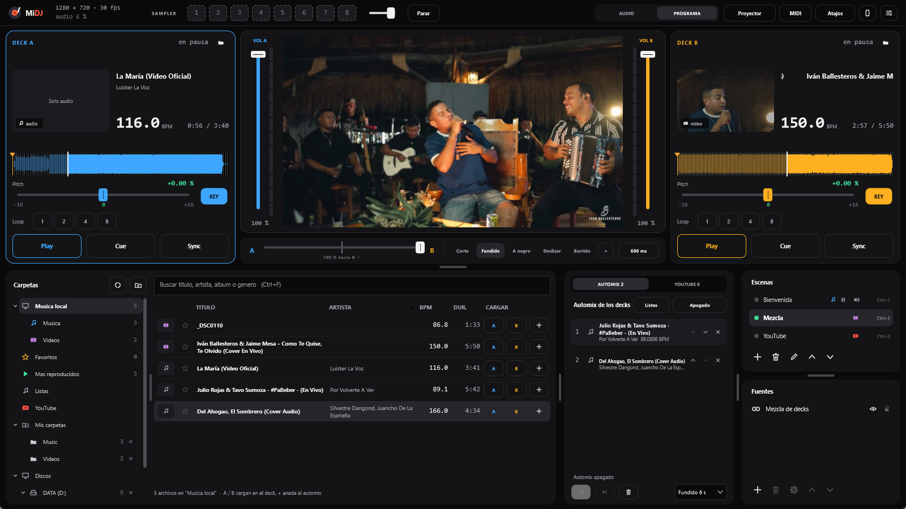
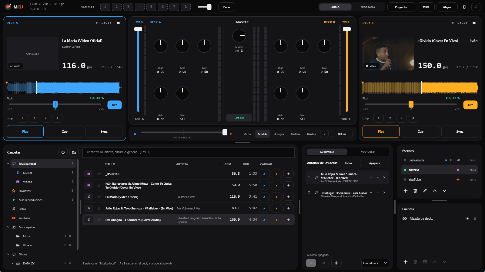
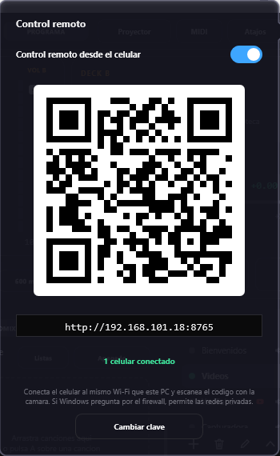
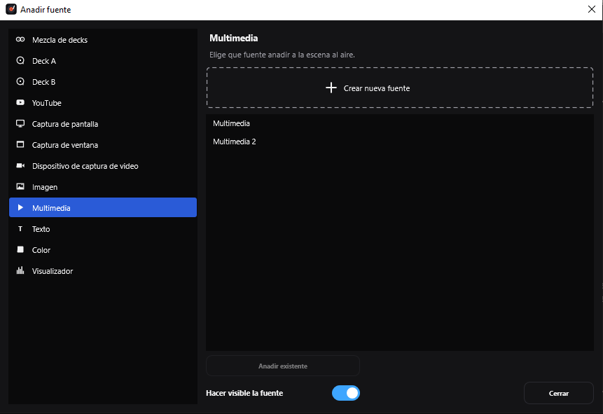
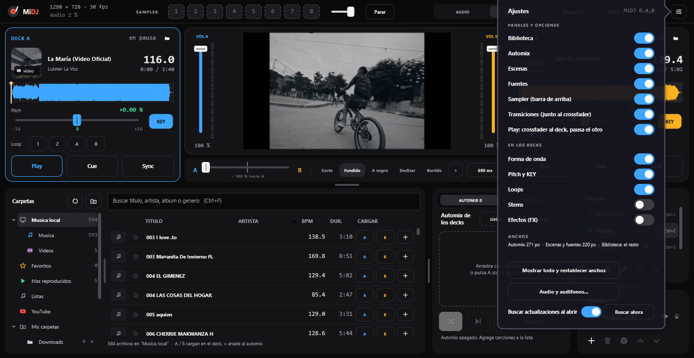

  

  <b>Mezcla música y video en un solo programa.</b> 
  Dos decks como en VirtualDJ y escenas como en OBS, gratis y para Windows.

  <a href="https://github.com/hamed0210/MiDJ/releases/latest"><b>⬇️ Descargar MiDJ para Windows</b></a>

## Instalar

1. Descarga **`MiDJ-Setup-<versión>.exe`** de la [última versión](https://github.com/hamed0210/MiDJ/releases/latest).
2. Ábrelo y sigue el asistente (no hace falta ser administrador).
3. Abre **MiDJ** desde el escritorio o el menú Inicio.

Necesitas **Windows 10 (1903 o posterior) u 11** de 64 bits. Windows puede avisar de que el programa
no es conocido (*Windows protegió tu PC*): pulsa **Más información > Ejecutar de todas formas**.

### Actualizar

MiDJ te avisa solo cuando sale una versión nueva: muestra las novedades y, con **Descargar e instalar**,
se actualiza en un minuto. Tus canciones, escenas y ajustes se conservan. También puedes mirarlo cuando
quieras en **Ajustes > Buscar ahora**.

## Qué puedes hacer

### 🎚️ Mezclar como un DJ

Dos decks con forma de onda, **BPM** automático, **SYNC**, **CUE**, bucles, pitch con **keylock** (cambia el
tempo sin cambiar el tono) y tres **efectos** a tempo por deck (eco, reverb, flanger...). En el centro: EQ de
3 bandas, filtro, volúmenes y crossfader. Con **audífonos** puedes pre-escuchar la siguiente canción.

### 🎤 Quitar la voz (stems con IA)

El botón **STEMS** separa la voz del instrumental. Apaga la voz para un karaoke o deja solo la voz para
una mezcla a capela.

### 🔁 Automix

Arrastra canciones a la lista del **automix** y MiDJ las mezcla solo: a tempo cuando se puede y con
fundido cuando no. Ideal para descansar o para música de fondo.

### 📱 Control remoto desde el celular

Pulsa el botón del **celular** (arriba a la derecha), enciéndelo y escanea el **código QR** con la cámara
del celular: se abre el control en el navegador, sin instalar nada. Desde ahí das Play, mueves volúmenes y
crossfader, buscas canciones (en tu biblioteca o en YouTube) y las cargas en un deck o en el automix, disparas
los pads y cambias de escena.
El celular tiene que estar en el **mismo Wi-Fi** que el PC.

### 📚 Biblioteca

Añade tus carpetas y MiDJ analiza el BPM de cada canción. Busca al instante, marca **favoritas** ⭐, mira
las **más reproducidas** y arma tus propias **listas**.

### ▶️ YouTube

Busca videos de YouTube desde la biblioteca, ponlos a sonar y llévalos a la salida de video. Tienen su
propio automix. Si tienes **YouTube Premium**, inicia sesión y no verás anuncios.

### 🎬 Video y escenas como en OBS

Carga videos musicales (MP4, MOV...) en los decks: la imagen sigue a la música y se mezcla con el
crossfader. Arma **escenas** con capturas de pantalla, capturadoras HDMI o webcams, imágenes, textos con el
título de lo que suena y un **visualizador** que baila con la música. Cambia de escena con transiciones
(incluso con un video *stinger*) y saca la imagen a pantalla completa en un **proyector** o una TV.

### 🎹 Sampler y controladoras

8 pads para efectos de sonido (acepta los `.vdjsample` de VirtualDJ) y graba trozos de un deck. Conecta
cualquier **controladora MIDI** y asigna sus botones con un clic en la pantalla.

## Atajos más usados

| Tecla | Qué hace |
|---|---|
| **Espacio** | Pausa lo que suena (otra vez: vuelve a sonar) |
| **Tab** | Cambia de deck |
| **Intro** | Carga la canción elegida en el deck |
| **← / →** | Mueve el crossfader |
| **A** | Agrega la canción al automix |
| **1 - 8** | Pads del sampler |
| **Ctrl + 1 - 9** | Cambia de escena |
| **V** | Alterna entre AUDIO y PROGRAMA |

Todos los atajos están en el botón **Atajos** del programa.

## Más información

- 📖 [Manual completo](docs/MANUAL.md): todas las funciones explicadas una por una.
- 🛠️ [Desarrollo](docs/DESARROLLO.md): cómo compilar MiDJ, cómo está hecho y qué cambió en cada versión.
- 🐞 ¿Algo no funciona? [Cuéntalo aquí](https://github.com/hamed0210/MiDJ/issues).
