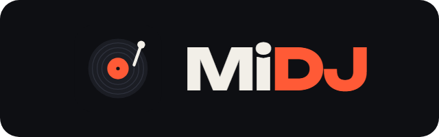

# MiDJ



Aplicación de DJ y video para Windows escrita en C++20 con [JUCE](https://juce.com): dos decks con
keylock, SYNC, efectos, stems con IA y video; sampler, automix, audífonos con pre-escucha, biblioteca
con favoritos y listas, escenas y fuentes como OBS (capturas, capturadoras, visualizador) y YouTube.

## Requisitos

| Herramienta | Versión | Dónde está en este equipo |
|---|---|---|
| Visual Studio 2022 Build Tools (C++) | 17.x | `C:\Program Files (x86)\Microsoft Visual Studio\2022\BuildTools` |
| CMake | 3.22 o superior | `D:\Tools\cmake\bin` |
| JUCE | 8.0.4 | `D:\Tools\JUCE` (otra ruta: `-DJUCE_DIR=...`) |
| Rubber Band | 4.0.0 | `D:\Tools\rubberband` (otra ruta: `-DRUBBERBAND_DIR=...`) |
| SQLite (amalgamation) | 3.46.1 | `D:\Tools\sqlite` (otra ruta: `-DSQLITE_DIR=...`) |
| ONNX Runtime + DirectML | 1.20.1 / 1.15.4 | `D:\Tools\onnxruntime` (otra ruta: `-DONNXRUNTIME_DIR=...`) |
| Modelo Spleeter 2 stems int8 | sherpa-onnx | `D:\Tools\models\spleeter-2stems-int8` (se copia junto al programa) |
| WebView2 SDK (cargador estático) | 1.0.3240.44 | `D:\Tools\WebView2` (otra ruta: `-DWEBVIEW2_DIR=...`) |
| Inno Setup (solo para el instalador) | 6.7 | `%LOCALAPPDATA%\Programs\Inno Setup 6` |
| Git | cualquiera | ya instalado |

Para usar MiDJ hace falta Windows 10 1903 o posterior. YouTube usa además el motor WebView2 de Microsoft,
que traen Windows 11 y casi todos los Windows 10 (si falta, el instalador lo avisa).

## Compilar y ejecutar

Desde una terminal en esta carpeta:

```bat
D:\Tools\cmake\bin\cmake --preset vs2022
D:\Tools\cmake\bin\cmake --build --preset debug
D:\Tools\cmake\bin\ctest --preset debug
build\MiDJ_artefacts\Debug\MiDJ.exe
```

Para una versión optimizada usa `--preset release` en la compilación.

### Instalador

Con la versión Release compilada, el instalador se arma con Inno Setup:

```bat
"%LOCALAPPDATA%\Programs\Inno Setup 6\ISCC.exe" Installer\MiDJ.iss
```

Deja `build\installer\MiDJ-Setup-<versión>.exe`. Instala para el usuario (sin administrador) o para todos;
lleva el programa, ONNX Runtime y DirectML, el modelo de stems y las DLL de Visual C++ (no hace falta el
paquete de Microsoft), accesos directos y desinstalador. Los datos de `%APPDATA%\MiDJ` (biblioteca, escenas,
ajustes) no se tocan ni al instalar ni al desinstalar.

**Actualizar:** si MiDJ ya está instalado, el instalador lo detecta y muestra solo una página, *Actualizar
MiDJ 0.2.0 -> 0.3.0*: usa la misma carpeta, el mismo modo (usuario o todos) y los mismos accesos directos, y
cierra MiDJ si está abierto. Con la misma versión ofrece *Reinstalar*; si lo instalado es más nuevo, avisa antes
de volver a la anterior. Para cada versión nueva basta con cambiar `AppVersion` en `Installer\MiDJ.iss` (y
`VERSION` en `CMakeLists.txt`).

### Logo

El logo (un disco de vinilo con su brazo) está en `Resources\Logo`: `icon.svg` e `icon-small.svg` (hasta
32 px) son los originales; el icono del programa, `MiDJ.ico` del instalador, las imágenes del asistente y
`logo.png` se generan con Edge a partir de ellos:

```bat
powershell -ExecutionPolicy Bypass -File Resources\Logo\render.ps1
```

Dentro de la aplicación (barra de arriba y fondo de la salida de video) se dibuja con `Source\Brand\Logo.*`.

## Estructura

```
Source/
  Main.cpp              arranque de la aplicación y ventana
  MainComponent.*       ventana principal: une motor e interfaz
  Brand/Logo.*          el logo dibujado (disco y nombre)
  Engine/               motor de audio (sin interfaz, se puede probar solo)
    Deck.*              un plato: carga, reproduce, velocidad, BPM
    Mixer.*             mezcla de dos decks con crossfader
    MasterTap.*         lo que sale por el master y su pulso, para el visualizador
    AuxAudio.*          sonidos que no son de los decks al master (multimedia, capturadora)
    HeadphoneOutput.*   audifonos por otra tarjeta de sonido (cola con correccion de reloj)
    ChannelStrip.*      canal de un deck: ganancia, EQ de 3 bandas, filtro, volumen
    BpmDetector.*       detección de tempo y del primer pulso
    TimeStretcher.*     keylock: cambio de tempo sin cambio de tono (Rubber Band)
    Effects.*           efectos sincronizados al tempo y rack de 3 ranuras por deck
    Sampler.*           sampler de 8 pads: disparo, tempo, grabacion y banco
    Automix.*           automix de dos decks: lista, plan de cada transicion y mezcla
    MixPoints.*         puntos de automix de una cancion (sonido, fundido, parte ritmica)
    StemSeparator.*     separacion de voz con IA (Spleeter en ONNX Runtime)
    StemsService.*      cola de separacion en segundo plano y cache de stems
    SampleData.*        sonidos del sampler: audio y .vdjsample de VirtualDJ
  Video/                video
    MediaFoundation.*   audio y video de MP4/MOV/WMV/M4A con Media Foundation de Windows
    DeckVideo.*         hilo de video de un deck: el fotograma que toca segun su posicion
    Compositor.*        compositor en la GPU (Direct3D 11) a ritmo fijo y sus salidas (como OBS)
    VideoMix.*          capas de cada fotograma: los decks segun el crossfader, rotulos y logo
    Scenes.*            escenas y elementos (como OBS): fuentes, colocacion, recorte y XML
    VideoProgram.*      la escena al aire, sus capas y las transiciones entre escenas
    Capture.*           captura de pantalla (DXGI) y de ventana (Windows Graphics Capture) en la GPU
    Visualizer.*        visualizador del master: espectro, onda y pulso
    MediaSources.*      fuentes Multimedia (archivo) y Dispositivo de captura de video
    YouTubeSearch.*     busqueda en YouTube sin clave (lee la pagina de resultados)
  Control/              controladoras MIDI
    Actions.*           acciones asignables (play, cue, tempo, EQ, efectos, jog...)
    MidiMapping.*       asignaciones mensaje MIDI -> accion, guardadas en XML
    MidiController.*    dispositivos, modo aprender y traduccion de mensajes
    ControlSurface.*    ejecuta las acciones sobre decks, mezclador y efectos
  Library/              biblioteca de canciones
    Library.*           base SQLite, carpetas, escaneo, analisis de fondo y busqueda
    TagReader.*         etiquetas ID3 (v1, v2.2-2.4) y 'Artista - Titulo' del nombre
  UI/                   interfaz
    DeckComponent.*     panel de un deck: forma de onda, botones, tempo
    MixerComponent.*    centro: volumenes con pre-escucha, AUDIO (EQ, master, audifonos) / PROGRAMA, crossfader y transiciones
    LibraryBrowser.*    navegador: carpetas, favoritos, listas, YouTube, buscador y lista
    AutomixPanel.*      panel del automix: pestanas AUTOMIX y YOUTUBE, lista, encender, mezclar ya, saltar
    YouTubePlayer.*     reproductor de YouTube: WebView2 en una ventana fuera de las pantallas
    YouTubePanel.*      pestana YOUTUBE: lo que suena, avance, volumen y lista del automix de YouTube
    EffectsRow.*        fila FX de un deck: elegir efecto, encender y mando
    MidiLearnOverlay.*  capa del modo aprender MIDI
    SamplerPanel.*      panel del sampler: pads, volumen y STOP
    VideoWindow.*       escenario de video: vista previa, proyectores y edicion con el raton
    ScenePanel.*        paneles Escenas y Fuentes (como los de OBS)
    SourceDialogs.*     dialogos Anadir fuente y Propiedades (como los de OBS)
    Icons.*             iconos dibujados de botones, fuentes y tipos de archivo
    DarkLookAndFeel.*   estilo visual oscuro
Tests/
  TestMain.cpp          pruebas automáticas del motor (ctest) y herramientas:
                        MiDJTests --analyse canciones...      BPM y primer pulso
                        MiDJTests --stretch cancion 1.08 dir  keylock con una canción real
                        MiDJTests --compare a.wav b.wav       tono de b respecto de a
                        MiDJTests --sample archivo            datos de un sonido (.vdjsample o audio)
                        MiDJTests --mixpoints canciones...    puntos de automix
                        MiDJTests --stems cancion [cpu|gpu] [s] separa voz e instrumental (WAV)
                        MiDJTests --video archivo             coste de decodificar un video en la GPU y en la CPU
                        MiDJTests --benchmark                 CPU del keylock y de los efectos
Installer/
  MiDJ.iss              instalador (Inno Setup): instala o actualiza
Resources/
  Logo/                 logo: SVG originales, render.ps1 y las imagenes que genera
```

## Interfaz y atajos de teclado

Diseño "Escenario" (oscuro, deck A en azul y B en ámbar), pensado para una pantalla de 1366x768:
- **Arriba**, una barra con el formato de la salida de video, el **sampler** (8 pads, volumen y Parar), las
  pestañas **AUDIO / PROGRAMA** del centro, **Proyector** (pantalla completa en un monitor), **MIDI**,
  **Atajos** y **Ajustes**.
- **Decks** a los lados: portada (un fotograma si es un video), título, artista, BPM y tiempo, la forma de
  onda delgada (lo ya sonado más apagado), el **pitch** ±16 % con el centro marcado (raya y 0 en verde cuando
  está en 0; se engancha al pasar cerca; doble clic: 0) y **KEY**, bucles 1-2-4-8, stems (Voz / Instrumental
  o "Separar stems"), tres efectos (el nombre enciende, la flecha elige otro, el mando es la cantidad) y
  Play, Cue y Sync.
- **Centro**: a los lados el **volumen** de cada deck (fader con vúmetro y, con audífonos, su botón de
  pre-escucha) y en medio la página elegida: **PROGRAMA** (la salida de video, lo más grande que quepa) o
  **AUDIO** (High, Mid, Low, Gain y Filter de cada deck con su vúmetro, el **master** con su volumen y
  vúmetro estéreo y, con audífonos, sus mandos). Debajo, en una línea, el **crossfader** con su centro
  marcado (CENTRO en verde o "40 % hacia B"; se engancha y doble clic lo centra) y la **transición** entre
  escenas (las de siempre, las propias y **+**) con su duración (botón: lista de duraciones).
- **Abajo**: biblioteca, automix y escenas/fuentes; las barritas entre ellos (y entre el árbol y la lista, y
  entre Escenas y Fuentes) cambian el tamaño (doble clic: el original).
- **Ajustes**: ocultar Biblioteca, Automix, Escenas, Fuentes, Sampler o Transiciones; el crossfader
  automático; en los decks, la forma de onda, el pitch y KEY, los loops, los stems o los efectos (el deck se
  compacta sin huecos y lo de abajo crece); **Audio y audífonos...** (ver abajo) y restablecer. Se guarda en
  `%APPDATA%\MiDJ\layout.xml`; la ventana recuerda su tamaño, posición y si estaba maximizada (`window.txt`).
- **Crossfader automático**: al dar Play a un deck que el crossfader deja apagado, si el otro no suena, el
  crossfader pasa a su lado en 0,4 s (no con el automix encendido).

El **deck activo** (marco del color del deck) es el de los atajos: se elige con un clic en el deck, con
Tab o cargando una canción en él. Botón **Atajos**:

| Tecla | Acción |
|---|---|
| Espacio | Pausa lo que suena (uno o los dos decks, o YouTube); otra vez: vuelve eso mismo. Sin nada sonando: Play del deck activo |
| Tab | Cambiar de deck activo |
| C / S / K | CUE / SYNC / Keylock del deck activo |
| Intro | Cargar la canción elegida en el deck activo (en YouTube: verla) |
| Flechas arriba / abajo (RePág / AvPág) | Moverse por la lista de canciones |
| Flechas izquierda / derecha | Crossfader a pasos del 5 % (con Mayús: del todo) |
| A | Agregar la canción elegida al automix (en YouTube: al automix de YouTube) |
| 1 - 8 | Pads del sampler (al soltar, se suelta el pad) |
| Ctrl+1 - 9 (o F1 - F9) | Pasar a la escena 1 - 9 (en portátiles HP las F necesitan la tecla Fn) |
| V | Pestaña AUDIO / PROGRAMA del centro |
| Ctrl+F | Buscar (Esc o Intro: salir del buscador) |
| Supr | Quitar la fuente elegida (vista previa o panel Fuentes) |

Mientras se escribe en el buscador o en un texto, las teclas escriben (no son atajos). Los botones no se
quedan con el foco al hacer clic, así que el espacio nunca vuelve a pulsar el último botón; los atajos llegan
aunque ningún control tenga el foco.

## Audio, audífonos y limitador

**Ajustes > Audio y audífonos...**: la tarjeta de sonido (tipo, salida, frecuencia y tamaño del bloque) y por
dónde van los **audífonos**:
- **Salidas 3 y 4** de una tarjeta de 4 canales (las controladoras con tarjeta propia);
- **partir la salida estéreo con un cable en Y**: izquierda = master en mono (a los parlantes), derecha =
  audífonos en mono; sirve con la salida normal de un portátil;
- **otra tarjeta de sonido** (p. ej. un adaptador USB de audífonos): se le pasa el audio por una cola de 40 ms
  que corrige la diferencia de reloj entre las dos tarjetas.

Con audífonos aparece un botón de **pre-escucha** bajo el volumen de cada deck (se oye tras el EQ y el filtro
y antes del volumen: el deck se puede escuchar con el fader abajo) y, en la página AUDIO, **Cue / Mst** (de solo
la pre-escucha a solo el master) y **Auricular** (volumen). Sin ningún deck en pre-escucha los audífonos oyen el
master. La pre-escucha también se asigna por MIDI.

El **limitador** del master (activado por defecto, se quita en el mismo diálogo) no deja que la salida pase de
-0,3 dBFS: baja la ganancia al momento y la recupera en 150 ms. Mientras actúa, el valor bajo los volúmenes
dice **LIM** en rojo. Todo se guarda en `%APPDATA%\MiDJ\audio.xml`.

## Biblioteca

Árbol de la izquierda:
- **Música local** (Música = solo audio, Videos = solo video).
- **Favoritos**: las canciones con la **estrella** encendida (clic en la estrella de la lista o clic derecho >
  Agregar a favoritos).
- **Más reproducidos**: las 50 que más han sonado (cuenta una vez por carga, a los 30 s sonando en un deck).
- **Listas**: listas de reproducción propias. Clic derecho en "Listas" > Nueva lista; en una canción >
  **Agregar a lista** (o a una nueva); arrastrar canciones encima de una lista. Dentro de una lista, clic
  derecho > Quitar de esta lista / Mover arriba / Mover abajo; en la lista del árbol: renombrar, borrar (las
  canciones no se borran) o reproducirla en el automix.
- **YouTube** (ver abajo).
- **Mis carpetas** (las añadidas) y **Discos** (cada disco y las carpetas donde hay canciones). La **x** de una
  carpeta o un disco lo quita de la biblioteca sin borrar archivos (las canciones quedan ocultas con su
  análisis y no vuelven al re-escanear) y sale un aviso con **Deshacer**. **Sincronizar** (flechas en círculo)
  busca música y/o video en los discos elegidos (sin Windows, Archivos de programa ni AppData) y añade las
  carpetas nuevas, que se analizan en segundo plano.

Cada canción tiene **A** / **B** (cargar en ese deck) y **+** (al automix); doble clic la carga en el deck libre.
Favoritos, reproducciones y listas se guardan en `library.db`.

## YouTube

**Biblioteca > YouTube**: se escribe en el buscador y se pulsa **Intro** (o se pega un enlace de YouTube).
Cada video tiene **Ver** (suena ya) y **+** (a la lista del automix de YouTube); clic derecho, también "como el
siguiente". Lo que suena se ve en la pestaña **YOUTUBE** del panel del automix: título, estado (Cargando,
Anuncio, Sonando...), avance (clic en la barra: saltar), Play/Pausa, Detener (cierra el reproductor) y volumen.

- El video se reproduce en una ventana con **WebView2** (el motor de Edge) que está fuera de las pantallas y
  solo existe mientras hay un video (unos 400 MB de RAM mientras está abierta). Abre la página normal de
  YouTube, así que se ven también los videos que no se dejan incrustar; los anuncios se ven igual que en el
  navegador. Pide H.264 a 720p, que decodifica la tarjeta gráfica.
- Al **programa** llega con la fuente de escena **YouTube** (Añadir fuente > YouTube), que captura esa ventana.
  Con una escena con "Pasar a esta escena automáticamente > Cuando suena YouTube", el programa pasa a ella
  sola mientras suena YouTube (manda sobre los decks).
- El **sonido** sale por la tarjeta predeterminada de Windows: no pasa por el mezclador de MiDJ (sin EQ ni
  crossfader); su volumen es el de la pestaña YOUTUBE.
- El **automix de YouTube** es el mismo automix con su propia lista (pestaña YOUTUBE, Encendido/Apagado,
  siguiente y vaciar): al terminar un video suena el siguiente; un video que no se puede ver se salta. Sin
  automix, al terminar se cierra el reproductor. La lista se guarda en `youtube.xml`.
- La ventana del reproductor aparece agrupada bajo el icono de MiDJ en la barra de tareas: si se quita de
  ahí, Windows no deja capturarla.
- Si YouTube cambia su página y algo deja de ocultarse o de funcionar, el script del reproductor se puede
  cambiar sin recompilar dejando un `youtube.js` en `%APPDATA%\MiDJ`.

## Automix

Panel **AUTOMIX** abajo, entre las canciones y las escenas: se le arrastran canciones (o clic derecho en una
canción > **Agregar a automix**, o tecla A). Encendido/Apagado, Mezclar ya, Saltar, Quitar, Vaciar y la
duración del fundido. **Listas**: reproducir (la lista pasa a ser esa y se enciende) o añadir al final los
Favoritos, los Más reproducidos o una lista propia. La pestaña **YOUTUBE** es el automix de YouTube, con su
propia lista (ver YouTube).
Cada transición se planifica como el modo Smart de VirtualDJ: **a tempo** (16 pulsos, compases alineados y el
tempo deslizándose de una canción a la otra) si la actual tiene fin de parte rítmica, la siguiente tiene inicio
y sus BPM difieren menos de un 6 %; si no, **fundido**. La lista se guarda al cerrar.

## Stems (voz / instrumental)

Botón **STEMS** de cada deck: separa la voz con IA en segundo plano (en este equipo tarda algo más que la
canción) y después aparecen **VOZ** e **INSTR** para apagar cada parte. También desde el navegador: clic derecho >
**Preparar stems**. La voz se guarda en `%APPDATA%\MiDJ\Stems` (FLAC) y la próxima vez se lee de ahí en segundos.
Por defecto se usa la CPU; la tarjeta gráfica (DirectML) se activa escribiendo `<STEMS device="gpu"/>` en
`%APPDATA%\MiDJ\stems.xml` (en la Radeon R5 de este portátil DirectML se cuelga, por eso no se prueba sola).

## Video

Los MP4, MOV, M4V, WMV y 3GP se cargan en un deck como cualquier canción (también M4A, AAC y WMA), con los
codecs de Windows (Media Foundation, sin FFmpeg). Pestaña **PROGRAMA** del centro (tecla V): la vista previa
del programa, que por defecto mezcla los dos decks según el crossfader (una canción sin video se ve como un
rótulo con el título y el artista). El video sigue la posición que se oye del deck: pitch, saltos, CUE y bucles.

Como en OBS, un compositor en la tarjeta gráfica (Direct3D 11) arma la imagen una vez por fotograma a ritmo
fijo (1280x720 a 30 fps) y la dibuja en cada salida; el fundido entre decks se hace en luz lineal (a la mitad
no oscurece). Salidas:
- **Vista previa** (pestaña PROGRAMA), para el DJ. Clic derecho > **Vista previa grande**: la misma en su propia
  ventana, para colocar las fuentes con comodidad.
- **Proyectores a pantalla completa**, uno por monitor, sin bordes ni cursor: doble clic en la vista previa
  abre o cierra el del segundo monitor; clic derecho, el menú con todas las pantallas y el estado del
  compositor (tarjeta, ms por fotograma, fotogramas perdidos). En el proyector: Esc o doble clic lo cierra.

Solo se compone y se decodifica mientras se ve la pestaña PROGRAMA, la vista previa grande o un proyector (el
sonido de las fuentes multimedia sigue aunque no se vea). El video se decodifica en la
tarjeta gráfica (DXVA) y, si falla, en la CPU. Ajustes en `%APPDATA%\MiDJ\video.xml`:
`<VIDEO device="cpu" width="1280" height="720" fps="30"/>` (`device="cpu"` fuerza la CPU; el resto, el
tamaño y el ritmo del programa). En este portátil (A8 + Radeon R5, Release) un video en un deck cuesta ~34 %
de un núcleo con la vista previa y ~5 % más con un proyector; componer, ~1,2 ms por fotograma.

### Escenas

Abajo a la derecha están los paneles **Escenas** y **Fuentes**, como los de OBS (se guarda en
`%APPDATA%\MiDJ\scenes.xml`; por defecto, una escena "Mezcla" con la mezcla de los decks):
- **Escenas**: clic para ponerla al aire con la transición elegida bajo el crossfader (Corte, Fundido,
  A negro, Deslizar o Barrido, de 0,1 a 3 s, o una propia); Ctrl+1-9 (o F1-F9) pasan a las nueve primeras.
  Botones para crear, borrar, renombrar y ordenar; clic derecho para duplicar y para **Pasar a esta escena
  automáticamente**: cuando lo que más se oye de los decks es una canción de audio, un video, cuando no suena
  nada (tras 1,5 s) o cuando suena YouTube (un icono en la lista lo indica). Solo actúa al cambiar: una escena
  elegida a mano se respeta hasta el próximo cambio.
- **Fuentes** de la escena (la de arriba se ve encima), con su ojo (mostrar u ocultar) y su candado (no se
  mueve en la vista previa). Botones: **+** abre **Añadir fuente** (a la izquierda los tipos: Mezcla de decks,
  Deck A, Deck B, YouTube, Captura de pantalla, Captura de ventana, Dispositivo de captura de video, Imagen,
  Multimedia, Texto, Color y Visualizador; a la derecha "Crear nueva fuente" o "Añadir existente", la misma
  fuente de otra escena, que comparte la captura o el video), quitar, propiedades y subir/bajar. Doble clic
  o el engranaje: **Propiedades para 'fuente'**, con su imagen arriba, sus ajustes (se ven al momento), la
  colocación (opacidad, giro, recorte, Ajustar a la pantalla, Restablecer) y Por defecto / Aceptar /
  Cancelar (Cancelar deja todo como estaba). En el texto, `{titulo}`, `{artista}` y `{bpm}` se cambian por la
  canción del deck que más se ve (por ejemplo "Ahora suena: {titulo}").
- En la vista previa: clic para elegir una fuente (recuadro rojo), arrastrar para moverla (se pega a los
  bordes y al centro; Mayús para no pegarse), arrastrar una esquina para escalarla sin deformar (Mayús para
  deformar), flechas para mover de 1 en 1 (Mayús: de 10 en 10) y Supr para quitarla.
- **Transiciones propias** (**+ Personalizada**, bajo el crossfader): nombre y tipo, con **Probar en el
  programa** (se hace sin cambiar de escena) y **Añadir transición** (queda elegida; su **x** la quita):
  - **Stinger**: un video tapa el cambio; la escena cambia debajo en el **punto de cambio** y su sonido va al
    master. Al elegir el video se toma su duración y el punto de cambio a la mitad. Media Foundation no da
    transparencia: el video se ve entero.
  - **Barrido**: la escena nueva entra por donde una imagen en grises es más oscura, con el borde suavizado
    (en la GPU); sin imagen, un barrido en diagonal.
  - **A color**: funde al color elegido y del color a la escena nueva.
  Se guardan en `scenes.xml` con las escenas.

### Captura de pantalla y de ventana

Como en OBS, la imagen capturada no sale de la tarjeta gráfica (se copia de textura a textura):
- **Captura de pantalla**: se elige el monitor (por defecto, el principal, encajado en el programa). Usa la
  duplicación del escritorio de DXGI, que en Windows 10 no pinta el borde amarillo, y dibuja encima el
  puntero del ratón (se puede quitar). Si la pantalla es de otra tarjeta gráfica, usa Windows Graphics Capture.
- **Captura de ventana**: se elige de la lista de ventanas abiertas (`[programa] título`, botón Actualizar).
  Usa Windows Graphics Capture (Windows 10 1903+): captura la ventana aunque esté tapada; con "Solo el
  contenido" quita la barra de título y los bordes. En Windows 10 la ventana capturada lleva un borde
  amarillo (lo pone Windows; en Windows 11 se quita). Se guarda el título, la clase y el programa: al abrir
  MiDJ se busca la misma ventana (mismo título, si no la misma clase, si no el mismo programa), y si se
  cierra y se vuelve a abrir, la captura vuelve sola.
- Debajo se ve el estado: tamaño capturado y método (DXGI o WGC), o por qué no captura. Dos fuentes que
  capturan lo mismo comparten la captura.

### Multimedia

Como la fuente Multimedia de OBS: un archivo de video o de audio (MP4, MOV, M4V, WMV, AVI, MKV, WebM, MP3,
M4A, WAV, FLAC...) con sus propiedades: **Archivo local** (Examinar), **Bucle**, **Reiniciar la reproducción
cuando la fuente esté activa** (al salir al aire empieza de cero y al dejar de estarlo se para), **Utilizar la
decodificación por hardware**, **No mostrar nada al terminar la reproducción**, **Cerrar archivo cuando esté
inactivo**, **Velocidad** (1-200 %), **Volumen** y **Silenciar**, y los controles Reproducir/Pausa, Detener y
Reiniciar con el tiempo. Su sonido va al master (se oye y lo ve el visualizador) y la imagen sigue al sonido;
sin pista de audio, sigue a su propio reloj. "Activa" es lo mismo que en OBS: visible en la escena al aire.

### Dispositivo de captura de video

Como el de OBS, para **capturadoras de video** (USB/HDMI) y webcams: las que Windows ve con su controlador UVC
o de Media Foundation (OBS usa DirectShow, que además ve algunas capturadoras antiguas). Propiedades:
**Dispositivo**, **Activar/Desactivar**, **Desactivar cuando no se muestre**, **Tipo de resolución/FPS**
(Dispositivo predeterminado o Personalizado, con **Resolución**, **FPS** y **Formato de video**: NV12, YUY2,
MJPG...), **Voltear verticalmente** y **decodificación por hardware** (el MJPG y la conversión a RGB en la
tarjeta gráfica). En las capturadoras USB/HDMI el sonido HDMI aparece en Windows como una entrada de audio
aparte ("USB3. 0 capture", "Digital Audio Interface"...): en **Dispositivo de audio** se elige (se propone
sola la que parece de la capturadora) y va al master con su **Volumen**, con una cola de 40 ms que corrige la
diferencia de reloj entre la capturadora y la tarjeta de sonido. El dispositivo solo se abre mientras se ve el
video (el audio sigue) y, si se desconecta, se vuelve a probar cada 2 s.

### Visualizador

Fuente que dibuja lo que suena por el master (lo que se oye, descontando la latencia de la tarjeta):
- **Espectro**: 48 barras de 40 Hz a 16 kHz, de -60 a 0 dB (con +3 dB por octava para que la música, que
  tiene más graves, se vea pareja). Suben rápido, bajan despacio y dejan una marca de pico.
- **Onda**: la forma de onda de los últimos 23 ms, empezando en un cruce por cero para que no tiemble.
- **Pulso**: un círculo que crece con el volumen y late con el pulso del deck que manda (el que suena; si
  suenan los dos, el que el crossfader deja más alto), más fuerte en el primero de cada compás, con un aro que
  sale en cada pulso. Sin ningún deck con BPM, late con los golpes de volumen.
- Propiedades: estilo y color (el resto, como cualquier fuente). Al cambiar de estilo se coloca en su sitio:
  espectro y onda abajo a lo ancho; pulso, un cuadrado en el centro.
- Se dibuja en la CPU escribiendo los píxeles directamente, en una imagen de como mucho 640 px de lado (el
  pulso, 320), y la tarjeta gráfica la escala. Coste medido en Release en este equipo (A8-7410), sobre la
  ventana de video con una canción: espectro +8 % de un núcleo, onda +3 %, pulso +10 %.

## Sampler

8 pads en la barra de arriba (teclas 1-8; el nombre del sonido sale al pasar el ratón). Clic en un pad vacío o arrastrar encima un archivo (o una canción del
navegador) para cargarlo; acepta audio y los `.vdjsample` de VirtualDJ con su tempo y bucle. Clic: disparar.
Clic derecho: grabar 4, 8 o 16 pulsos de un deck (empieza en el siguiente pulso y queda como bucle bloqueado),
modo de disparo (on/off, mantener, repetir), bucle, tempo (libre, sincronizado, bloqueado) y quitar.
El banco se guarda en `%APPDATA%\MiDJ\sampler.xml` y las grabaciones en `%APPDATA%\MiDJ\Grabaciones`.

## Controladoras MIDI

Botón **MIDI** (barra de arriba): clic en un control de la pantalla y después moverlo en la
controladora; queda asignado (verde). Clic derecho quita la asignación. Se guarda en
`%APPDATA%\MiDJ\midi.xml` y las controladoras que se conecten con la app abierta se detectan solas.

Sin controladora se puede probar con `MiDJ.exe --simular-midi archivo.txt`. Cada línea del archivo:

```text
# milisegundos  tipo(note/cc/pb)  canal  número  valor
20000 note 1 36 127
30000 cc 1 7 100
40000 pb 1 0 8192
```

## Licencias

Rubber Band es GPL. Para uso propio no hay problema; para vender MiDJ hace falta su licencia
comercial o cambiarla por otra librería (por ejemplo SoundTouch, LGPL). Solo `TimeStretcher.*` la usa.
SQLite es de dominio público. ONNX Runtime es MIT; DirectML.dll es redistribuible según su licencia de Microsoft;
los pesos de Spleeter son de Deezer con licencia MIT (exportados a ONNX por el proyecto sherpa-onnx, Apache 2.0).

## Reglas del motor de audio

- El hilo de audio (`getNextAudioBlock`) nunca reserva memoria, bloquea, lee disco ni toca la interfaz.
- Lo lento (leer el archivo, analizar el BPM) va en hilos aparte.
- Todo cambio de volumen se aplica con rampa dentro del bloque para evitar clics.

## Registro de cambios

- Esqueleto: dos decks, crossfader con curva smooth y detección de BPM.
- SYNC, CUE y bucles de 1-2-4-8 pulsos.
- Mezclador por deck: ganancia (hasta +12 dB), EQ de 3 bandas con kill (cruces en 200 y 6500 Hz), filtro de un mando (paso bajo / paso alto con zona muerta) y fader de volumen.
- Keylock (botón KEY, activado por defecto): cambio de tempo sin cambiar el tono con Rubber Band R2. Detector de BPM más fiable con música real: ataques de mezcla y graves en escala logarítmica y tempo elegido con un peine de 1-4 pulsos (corrige el 4/3 del reggaeton).
- Biblioteca en SQLite (`%APPDATA%\MiDJ\library.db`) y navegador: carpetas, escaneo y análisis de BPM en segundo plano, búsqueda sin acentos ni mayúsculas, columnas ordenables; cargar arrastrando a un deck (también desde el Explorador) o con doble clic. Las canciones ya analizadas cargan sin volver a analizar.
- Efectos: 3 ranuras por deck con Echo (medio pulso, cola al apagar), Reverb, Flanger (barrido de 8 pulsos), BitCrush (fórmula de VirtualDJ) y Gate (cuartos de pulso), todos sincronizados al BPM del deck, sin clics al encender, apagar o cambiar, y sin tocar la señal cuando están apagados.
- Controladoras MIDI: modo aprender en la pantalla, botones por nota o CC, faders por CC o pitch bend, jog y encoders relativos (detecta complemento a dos o desplazado), los controles de la pantalla siguen a la controladora, conexión en caliente y modo de simulación.
- Sampler de 8 pads: disparo on/off, mantener y repetir; tempo libre, sincronizado (plegado a 0,66-1,5) o bloqueado al pulso; fundidos de 128 muestras; grabación de 4/8/16 pulsos de un deck empezando en el pulso; lee los .vdjsample de VirtualDJ; banco guardado; pads asignables por MIDI.
- Automix de dos decks con puntos de automix calculados al cargar cada canción (sonido, fundido y parte rítmica, con las reglas de VirtualDJ): mezcla a tempo o con fundido, mezclar ya, saltar, lista guardada y acciones MIDI.
- Stems con IA: voz e instrumental con Spleeter 2 stems (ONNX Runtime, CPU o DirectML) separados en segundo plano con caché en disco; mezcla en el deck sin clics y exacta con los dos encendidos; botones VOZ/INSTR, preparar desde el navegador y acciones MIDI.
- Video: MP4/MOV/WMV (y M4A/AAC/WMA) en los decks con Media Foundation de Windows; un hilo de video por deck que sigue la posición que se oye (tras un salto, primer fotograma en ~0,1 s y alcanza al audio sin congelarse); ventana VIDEO con la mezcla según el crossfader, rótulo con título y artista para las canciones sin video y pantalla completa sin bordes en el segundo monitor.
- Video en la GPU: decodificación DXVA con Direct3D 11 (8 veces menos CPU en este equipo; saltos en ~45 ms) con vuelta a la CPU si falla, y sin decodificar mientras la ventana de video está cerrada.
- Compositor de video en la GPU como el de OBS (Direct3D 11, 1280x720 a 30 fps, fundido en luz lineal) con vista previa y proyectores a pantalla completa en cualquier monitor, sin bordes ni cursor; sin copias de fotogramas entre el decodificador y la GPU más allá de la subida.
- Escenas como en OBS: fuentes (mezcla de decks, deck A/B, imagen, texto con título/artista/BPM de la canción que suena, color) con posición, escala, giro, recorte y opacidad; edición con el ratón en la vista previa; transiciones Corte, Fundido, Fundido a negro, Deslizar y Barrido compuestas en la GPU; guardadas en `scenes.xml`.
- Captura de pantalla (duplicación de DXGI, con el puntero del ratón y sin el borde amarillo de Windows 10) y de ventana (Windows Graphics Capture, solo el contenido o con bordes) como fuentes de escena, sin salir de la GPU; la ventana se vuelve a encontrar al reabrir MiDJ o al reabrirla.
- Fuentes **Multimedia** (archivo de video o audio con bucle, reiniciar al activarse, no mostrar nada al terminar, cerrar si está inactiva, velocidad y su sonido al master) y **Dispositivo de captura de video** (capturadoras USB/HDMI y webcams con Media Foundation: resolución, FPS y formato, volteo, decodificación por hardware y el audio HDMI de su entrada de Windows, remuestreado con corrección de reloj), como en OBS.
- Interfaz como VirtualDJ + OBS: video integrado en la pestaña VIDEO del mezclador (vista previa, nivel de video por deck, transición), crossfader dentro del mezclador, sampler en la fila del medio, paneles inferiores ajustables a lo ancho (carpetas, canciones, automix en su propio panel, escenas y fuentes), diálogos Añadir fuente y Propiedades como los de OBS, ojo y candado por fuente, icono de audio o video en la lista, una sola forma de onda por deck y atajos de teclado (Espacio, Tab, C/S/K, Intro, flechas, A, 1-8, F1-F9, V, Ctrl+F).
- Interfaz "Escenario": estilo oscuro nuevo; decks con portada del video, pitch con el centro marcado y enganche, loops, stems, efectos y transporte; centro con pestañas AUDIO (EQ, filtro, vúmetros y volumen del master) y PROGRAMA, crossfader con centro marcado y volúmenes a los lados, sampler en fila; paneles de abajo con barritas de ancho y Ajustes para ocultarlos; biblioteca con árbol Música local / Mis carpetas / Discos, quitar con Deshacer y sincronizar con el PC; automix con iconos.
- Transiciones propias: stinger (video con punto de cambio y su sonido), barrido con imagen en grises (máscara en la GPU) y a color, con probar en el programa; guardadas en `scenes.xml`.
- Interfaz "Escenario" v2: programa grande con los volúmenes a los lados, sampler y pestañas AUDIO / PROGRAMA en la barra de arriba, crossfader y transiciones en una línea, forma de onda delgada y partes de los decks ocultables desde Ajustes (el deck se compacta y lo de abajo crece).
- Biblioteca: favoritos (estrella), más reproducidos (30 s sonando) y listas de reproducción propias; el automix las reproduce desde "Listas".
- Escenas automáticas (cuando suena audio, video, YouTube o nada), Ctrl+1-9 para las escenas, Espacio que pausa lo que suena y vuelve a eso mismo, crossfader automático al dar Play, Escenas y Fuentes ocultables por separado con barrita entre ellas.
- Audio: tarjeta de sonido, frecuencia y bloque en Ajustes; audífonos con pre-escucha por deck (salidas 3-4, cable en Y u otra tarjeta con corrección de reloj), mezcla cue / master y volumen; limitador del master a -0,3 dBFS. La ventana recuerda su tamaño y posición.
- YouTube: búsqueda sin clave en la biblioteca, reproductor WebView2 fuera de las pantallas (página normal, H.264, anuncios incluidos), fuente de escena YouTube, escena automática y automix de YouTube con su propia lista.
- Instalador con Inno Setup (para el usuario o para todos, con las DLL de Visual C++ y aviso si falta WebView2) que actualiza una instalación anterior en su sitio.
- Logo: disco de vinilo con su brazo, como icono del programa y del instalador, en la barra de arriba y en el fondo de la salida de video.
